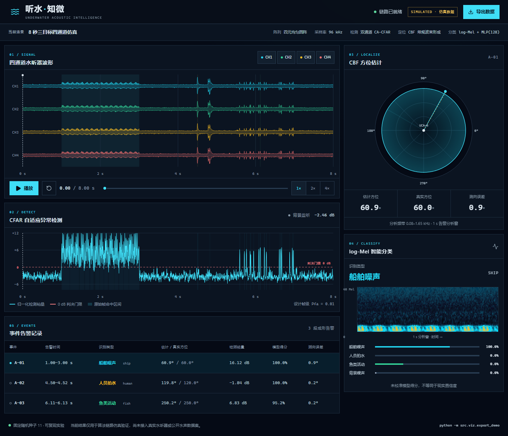

# 听水·知微

**基于四元水听器阵列的水声信号检测、测向、分类与可视化仿真系统**

大学生创新训练项目（2026.05—2027.05）· 国防科技大学

> **当前阶段：算法链路仿真验证。** 仓库中的场景、训练数据和实验结果均由程序生成，尚未接入真实水听器、公开水声数据集或无人船硬件，不能当作真实水域实测结论。

## 先看演示

- **公开网页：** https://fz6snaqu3vhym.ok.kimi.link
- **代码导读：** [docs/code-walkthrough.md](docs/code-walkthrough.md)
- **答辩讲解稿：** [docs/presentation-script.md](docs/presentation-script.md)
- **进度与验证记录：** [docs/handoff.md](docs/handoff.md)

网页无需登录，可直接切换三段告警，查看四通道波形、CFAR 检测、CBF 方位谱、log-Mel 特征和分类模型得分。网页是固定仿真场景的交互回放，不是实时采集系统；本地代码更新后需要重新发布，网页不会自动更新。



## 这套程序做什么

输入一段四通道水声波形，程序依次回答三个问题：

1. **有没有异常声音？** 用频谱谱线 CFAR 与宽带能量 CFAR 找出候选事件。
2. **声音从哪个方向来？** 用四元均匀圆阵和 CBF 扫描 0—360° 方位；另提供 MUSIC 对比实验。
3. **声音更像哪一类？** 提取 log-Mel 时频特征，用 MLP 区分船舶、人员拍水、鱼类活动和背景噪声。

最后把真实运行结果导出为 JSON，由 React 工作台联动展示。

```text
仿真声源 / 未来的真实采集
          │  x: (4, N)，fs = 96 kHz
          ▼
   双通道 CA-CFAR 检测
          │  告警起止时间、检测统计量
          ▼
   以告警为中心截取 1 s 分析窗
          │
          ├──────────────► CBF 四通道测向
          │
          └──────────────► log-Mel + MLP 单通道分类
                                      │
                                      ▼
                           JSON 导出 + 可视化告警
```

## 环境与克隆

已在 **Python 3.12、Node.js 24、Windows** 环境验证。其他版本未逐一验证；Python 依赖见 `requirements.txt`，前端准确依赖版本由 `app/package-lock.json` 锁定。

```bash
git clone https://github.com/rovan666/tingshui-zhiwei.git
cd tingshui-zhiwei
python -m venv .venv
```

激活虚拟环境：

```powershell
# Windows PowerShell
.venv\Scripts\Activate.ps1

# Windows CMD
.venv\Scripts\activate.bat

# macOS / Linux
source .venv/bin/activate
```

安装 Python 依赖：

```bash
python -m pip install -r requirements.txt
```

## 运行完整算法链路

```bash
python run_pipeline.py
```

固定随机种子为 11。当前场景共 8 秒，包含三段仿真事件；终端会打印检测时间、估计方位、类别和模型得分。

| 告警 | 时间 | 类型 | 估计方位 | 场景设定方位 |
|---|---|---|---:|---:|
| A-01 | 1.00—3.00 s | ship | 60.9° | 60° |
| A-02 | 4.50—4.52 s | human | 119.8° | 120° |
| A-03 | 6.11—6.13 s | fish | 250.2° | 250° |

这些数字只说明当前固定仿真场景的输出可复现，不代表对任意水域、目标或阵列都具有相同精度。

运行 8 项 Python 回归测试：

```bash
python -m unittest discover -s tests -v
```

## 启动可视化工作台

先在**仓库根目录**重新导出算法结果，再安装和启动前端：

```bash
python -m src.viz.export_demo
cd app
npm ci
npm run dev
```

打开终端中 Vite 给出的本地地址。默认端口为 3000；也可指定：

```bash
npm run dev -- --host 127.0.0.1 --port 7100
```

前端检查：

```bash
npm run lint
npm run build
```

如需运行 3 项 Playwright 界面测试，先让开发服务器运行在 `127.0.0.1:7100`，再在 `app/` 的另一个终端执行：

```bash
npx playwright install chromium
npm run test:ui
```

界面测试会更新 `figures/day4/` 中的桌面和移动端截图。

## 分模块实验

以下命令都从仓库根目录运行：

| 命令 | 内容 | 主要输出 |
|---|---|---|
| `python run_demo_d1.py` | 四元圆阵仿真与 CBF 方位谱 | `figures/day1/` |
| `python run_demo_music.py` | 0 dB / −10 dB 下 CBF 与 MUSIC 对比 | `figures/day2/cbf_vs_music.png` |
| `python run_demo_cfar.py` | CFAR 检测率与多口径虚警统计 | `figures/day3/cfar_*.png` |
| `python run_demo_classify.py` | 重新训练 MLP、混淆矩阵与 log-Mel 图 | `figures/day3/classify_*.png`、`models/mlp_classifier.pkl` |
| `python run_pipeline.py` | 检测 → 测向 → 分类完整链路 | 终端告警 |
| `python -m src.viz.export_demo` | 导出页面使用的真实仿真输出 | `app/public/demo-data.json` |

重新训练会覆盖现有模型，并可能改变后续告警得分；修改模型前建议先创建 Git 分支。

> **安全提示：** `models/mlp_classifier.pkl` 是 Python pickle 文件。pickle 只能加载可信来源，不要运行来历不明的模型文件。当前文件由本仓库的 `run_demo_classify.py` 生成，保留它是为了让克隆者无需先训练就能运行完整链路。

## 代码阅读地图

| 顺序 | 文件 | 需要看懂的问题 |
|---:|---|---|
| 1 | `run_pipeline.py` | 各模块怎样串联，数据形状怎样变化 |
| 2 | `sim/uca_sim.py` | 阵元坐标、传播时延和四通道信号怎样产生 |
| 3 | `sim/sources.py` | 船舶、拍水、鱼类和背景信号怎样模拟 |
| 4 | `src/detect/cfar.py` | 为什么要谱线＋能量双通道，0 dB 判决线是什么 |
| 5 | `src/doa/cbf.py` | 怎样通过补偿时延和扫描角度估计方向 |
| 6 | `src/doa/music.py` | 信号子空间、噪声子空间和谱峰的关系 |
| 7 | `src/classify/features.py` | 波形怎样变成 40 维 log-Mel 时频图 |
| 8 | `src/classify/mlp.py` | 数据集、训练、推理和模型得分怎样产生 |
| 9 | `src/viz/export_demo.py` | 算法输出怎样变成网页 JSON，而不是前端手填 |
| 10 | `app/src/App.tsx` | 告警切换、播放、通道开关和图表怎样联动 |
| 11 | `tests/test_detection_pipeline.py` | 哪些历史问题已经被自动化测试锁住 |

建议配合 [代码导读](docs/code-walkthrough.md) 按这个顺序阅读。

## 仓库结构

```text
├── run_pipeline.py          # 完整仿真流水线入口
├── run_demo_*.py            # 各算法独立实验
├── sim/                     # 阵列与多类声源仿真
├── src/
│   ├── detect/              # 双通道 CA-CFAR
│   ├── doa/                 # CBF 与 MUSIC
│   ├── classify/            # log-Mel 与 MLP
│   └── viz/                 # 可视化数据导出
├── app/                     # React + TypeScript 工作台
├── models/                  # 已训练的可信演示模型
├── tests/                   # Python 回归测试
├── figures/                 # 实际运行生成的图表与截图
└── docs/
    ├── code-walkthrough.md  # 逐模块中文导读
    ├── presentation-script.md # 代码与网页讲解稿
    ├── algorithm-framework.md # 接口和全局约定
    ├── handoff.md           # 真实进度、验证和遗留问题
    └── hardware/BOM.md      # 硬件物料草稿，尚非采购定稿
```

## 已完成与不能越界的结论

### 已完成

- 四元圆阵与三类目标／背景噪声仿真。
- CFAR 检测、CBF 测向、log-Mel＋MLP 分类的端到端链路。
- CBF 与 MUSIC 的独立对比实验。
- 8 项 Python 回归测试；前端 lint、构建及 3 项 Playwright 测试。
- 可公开访问的桌面／移动端可视化演示。

### 当前限制

- **没有真实水域实验。** 分类训练集和测试集来自同一类仿真生成器，96.2% 仅是当前仿真划分的测试结果，不是真实识别准确率。
- **模型得分不是现实置信度。** MLP 输出未经校准，不能解释成“现实中有 95% 的把握”。
- **CFAR 结论有适用范围。** 当前帧级虚警率校准只覆盖仿真高斯白噪声；有色噪声、非平稳背景和真实水声环境下必须重新估计门限。
- **MUSIC 尚未进入主流水线。** 当前端到端演示使用 CBF；多途、相干源、多目标和移动声源仍需扩展。
- **没有硬件闭环。** 尚不控制电机或无人船；BOM 和结构资料仍需选型、比价、水密与装配验证。
- **网页不是实时流式系统。** “播放”是固定仿真数据的时间游标回放，不代表正在采集或播放真实音频。

## 协作约定

修改接口前先读 `docs/algorithm-framework.md`；每次工作结束更新 `docs/handoff.md`。所有实验必须真实运行，仿真图必须明确标注，不能把计划项写成已完成项。
